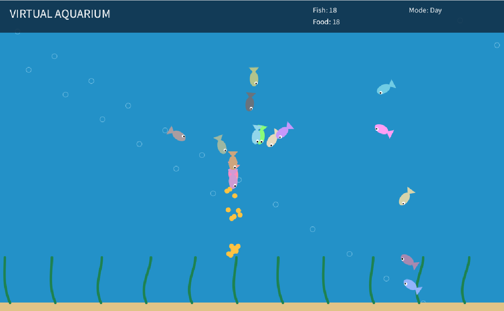
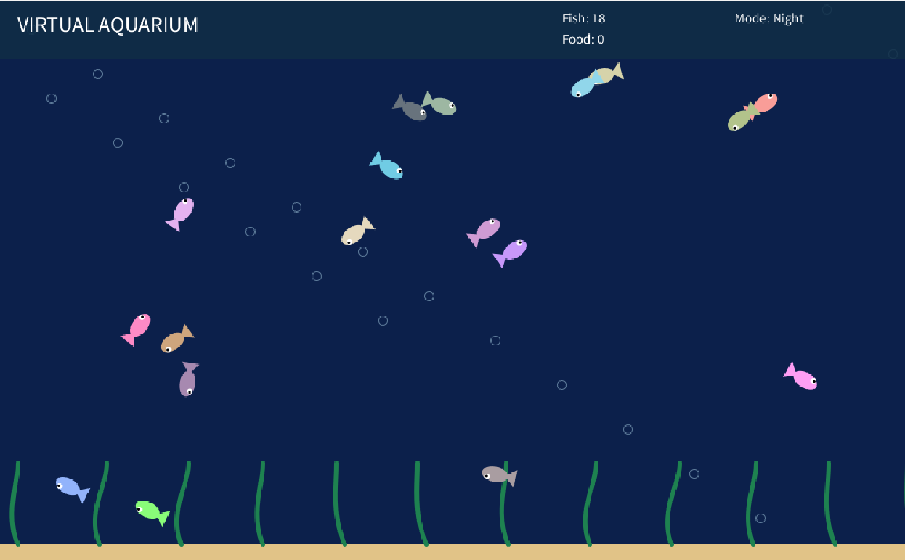

# SOFE4850_A1

# Virtual Aquarium — Interactive Systems in Processing

## Project Overview

Virtual Aquarium is an interactive aquarium simulation developed using Processing. The application demonstrates animation, object-oriented programming, and user interaction through a collection of independently moving fish.

Users can interact with the aquarium by feeding the fish, moving the mouse cursor near them, and using keyboard controls to change the environment.

## Group Members

- Member 1: [Hashir Rashid - 100910330]
- Member 2: [Yahya Zouhar - 100922007]
- Member 3: [Ivan Arudpiragasam - 101011012]

## Features

### 1. Fish Movement

The aquarium contains 18 fish that swim independently. Each fish has its own position, velocity, speed, and colour.

Fish move in random directions while avoiding the aquarium boundaries.

### 2. Feeding System

Users can click inside the aquarium to create food particles. Nearby fish detect these particles and swim toward them.

Food particles disappear when consumed or when their lifetime expires.

### 3. Mouse Avoidance

The mouse cursor acts as a predator. Fish swim away when the cursor gets too close.

### 4. Day and Night Mode

Users can change the aquarium's background between daytime and nighttime using the keyboard.

### 5. Additional Controls

The application supports pausing, resuming, and resetting the aquarium.

## How to Run

1. Download and install Processing from https://processing.org/download.
2. Open the `VirtualAquarium` folder.
3. Open `VirtualAquarium.pde` using Processing.
4. Ensure that Processing is in Java mode.
5. Click the Run button.

## Controls

| Input          | Action                |
| -------------- | --------------------- |
| Mouse click    | Add food particles    |
| Mouse movement | Scare nearby fish     |
| N              | Toggle day/night mode |
| P              | Pause/resume          |
| R              | Reset the aquarium    |

## Project Structure

- `VirtualAquarium.pde`: Main application loop and initialization.
- `Fish.pde`: Fish class and swimming behaviors.
- `Food.pde`: Food particle class.
- `Interactions.pde`: User input and keyboard controls.
- `UI.pde`: Visual design and user interface.

## Implementation

The project uses Processing's `setup()` and `draw()` functions to initialize and continuously update the aquarium.

Fish and food particles are implemented as separate classes.

An `ArrayList` manages the collection of fish and food objects.

The `PVector` class represents fish positions and velocities.

Fish movement is influenced by random wandering, nearby food particles, the mouse cursor, and aquarium boundaries.

## Screenshots

[Insert screenshot of the aquarium during daytime.]

[Insert screenshot showing fish interacting with food.]

[Insert screenshot demonstrating nighttime mode.]

## Testing

Functional testing
0/12 passed

[ ] The application starts without errors.
[ ] At least 15 fish are visible.
[ ] Fish move in different directions.
[ ] Fish avoid the aquarium walls.
[ ] Clicking creates visible food particles.
[ ] Fish chase nearby food particles.
[ ] Food disappears after being eaten.
[ ] Fish swim away from the mouse cursor.
[ ] N changes the background colour.
[ ] P pauses and resumes movement.
[ ] R resets the aquarium.
[ ] The application remains responsive during repeated interaction.

## Group Contributions

[Describe the final contributions of each member, including implementation, testing, documentation, and integration.]
