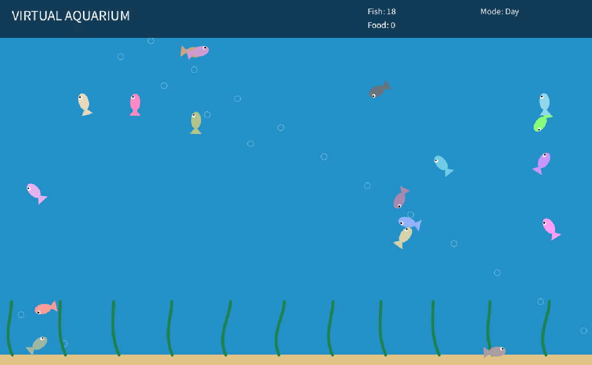

# User Experience Design — Assignment 1: Virtual Aquarium

## Project Overview
Virtual Aquarium is an interactive aquarium simulation developed using Processing. The application demonstrates animation, object-oriented programming, and user interaction through a collection of independently moving fish.Users can interact with the aquarium by feeding the fish, moving the mouse cursor near them, and using keyboard controls to change the environment.

## Group Members

- Member 1: [Hashir Rashid - 100910330]
- Member 2: [Yahya Zouhar - 100922007]
- Member 3: [Ivan Arudpiragasam - 101011012]

## Features
### 1. Fish Movement
The aquarium contains 18 fish that swim independently. Each fish has its own position, velocity, speed, and color. Fish move in random directions while avoiding the aquarium boundaries.

### 2. Feeding System
Users can click inside the aquarium to create food particles. Nearby fish detect these particles and swim toward them. Food particles disappear when consumed or when their lifetime expires.

### 3. Mouse Avoidance
The mouse cursor acts as a predator. Fish swim away when the cursor gets too close.

### 4. Day and Night Mode
Users can change the aquarium's background between daytime and nighttime using the keyboard.

### 5. Additional Controls
The application supports pausing, resuming, and resetting the aquarium.

## How to Run
1. Download and install Processing from https://processing.org/download.
2. Navigate to your directory of choice and run this command in your terminal to download the code.
```bash
git clone https://github.com/ivanarud/SOFE4850_A1@latest
```
3. Open `VirtualAquarium.pde` using Processing.
4. Ensure that Processing is in Java mode.
5. Click the Run button.

## Project Structure
- `VirtualAquarium.pde`: Main application loop and initialization.
- `Fish.pde`: Fish class and swimming behaviors.
- `Food.pde`: Food particle class.
- `Interactions.pde`: User input and keyboard controls.
- `UI.pde`: Visual design and user interface.

## Controls
| Input          | Action                |
| -------------- | --------------------- |
| Mouse click    | Add food particles    |
| Mouse movement | Scare nearby fish     |
| N              | Toggle day/night mode |
| P              | Pause/resume          |
| R              | Reset the aquarium    |

## Example Output
**_Daytime_**


**_Feeding_**


**_Nighttime_**

